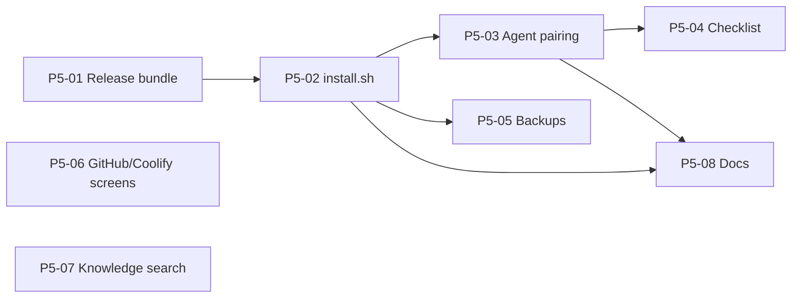

# Easy setup and the remaining v1 work

Status: approved 2026-11-06 · Owner: Scott Jordan. Phase 5 is now in `docs/plan/work-packages.yaml`, `docs/IMPLEMENTATION-PLAN.md` and `docs/IMPLEMENTATION-PLAN-DETAILED.md` (Part G2), which are the source of truth; this page is the readable summary.

This plan covers two things:

1. **Easy setup (new Phase 5).** One script installs everything Tumnis needs on a fresh server, Docker and Tailscale included, and a second one-line command adds the agent server. Today this takes 8 manual install steps, a 4.7 GB local image build, a separate daemon and profile install, and a certificate renewal every month.
2. **The remaining v1 work (Phase 3, deferred).** The Inbox Zero, Granola, chat and Google Docs connectors and the proposal flow that turns what they bring in into tasks, plus two gaps the README lists under "Not yet available".

The two tracks touch different files and can run side by side. Track A can start now. Track B starts with P3-01, which needs Scott's real Inbox Zero and Granola accounts.

The Phase 5 work packages follow the usual spec PR, then implementation PR flow (AGENTS.md).

## Where setup hurts today

| Today | After Phase 5 |
| --- | --- |
| Install Docker, the Compose plugin, git, openssl, curl, python3 and Tailscale yourself | `install.sh` installs whatever is missing |
| Clone a private repo | Download one script from the release |
| Set 4 shell variables, create 3 secret files with `sudo`, edit `.env` with `sed` | The script asks for an email address. It detects the time zone and the Tailscale name, then generates the secrets and `.env` |
| Run `tailscale cert`, and again every month (the certificate lasts 90 days) | Caddy fetches and renews the Tailscale certificate itself |
| Build two images locally (about 1 GB of downloads, a 4.7 GB extract image, a long wait) | Pull the release images |
| Run `curl` checks by hand | The script waits for `/health/ready` and prints the `/setup` link and a QR code for the phone |
| Agent server: install uv, Hermes and the daemon, create a user, write `daemon.toml`, copy a token, install a systemd unit, install 2 profiles, write each profile's `.env` with API keys minted by hand | Paste one command from Settings > Agents. A one-time pairing code sets up the token and the profile keys |
| Backups: write a pgBackRest secrets file by hand, flip a variable, restart | `install.sh backups` asks for the B2 bucket and key and does the rest |
| GitHub and Coolify connected through the API with `curl` | Settings screens |

## Track A: Phase 5, easy setup

Goal: someone with a fresh Ubuntu server and a Tailscale account has Tumnis running on their phone in under 15 minutes with one command, and agents running with one more.

Exit: on a fresh Ubuntu 24.04 VM with nothing installed, `install.sh --yes --email you@example.com` followed by the pairing command gives a working install where a fake-runner task completes. The README job runs this on every change to `deploy/`, nightly and on every release. `install.sh` run a second time changes nothing.

### P5-01 Release bundle and public images (M)

The script can only be simple if everything it needs is published.

- **Red**
  - The release workflow fails when any of these is missing from the release: the app image, the `-extract` image, the Postgres image (today `tumnis-postgres:18` is built from `deploy/postgres` on the server), and `tumnis-deploy-<tag>.tar.gz` (compose files, Caddy, pgBouncer, pgBackRest and Prometheus config, `.env.example`). P5-02 adds `install.sh` to this list and P5-03 adds `install-agent.sh`, each in the package that writes the script.
  - The release assets download without signing in, from the public `SpaceshipCreative/tumnis-install` repository's release of the same tag (open question 1).
  - `compose.yaml` names the Postgres image by registry and tag, and an install from the bundle alone (no git checkout) reaches `/health/ready`.
  - Images are published for `linux/amd64` and `linux/arm64` (see open question 3).
- **Green:** release workflow changes, the bundle tarball, the Postgres image pushed beside the app images, and a `latest` pointer the script can resolve.
- **Done:** the first release after v1.0.0 (which P4-06 tags) carries every asset, and an anonymous `docker pull` of each image and an anonymous download of each asset work (open question 1).

### P5-02 One-command server install (L)

`install.sh` replaces README steps 1 to 8. It is plain bash plus the tools it installs, with no extra dependency.

What it does, in order. Each step is skipped when its result already exists:

1. Checks the OS (Ubuntu 22.04 or 24.04, Debian 12) and the architecture, and that it can use `sudo`. Anything else gets a clear refusal that links to the manual install.
2. Installs whatever is missing: Docker Engine and the Compose plugin (Docker's apt repository), `curl`, `openssl` and `qrencode`. Tailscale comes from its apt repository unless `--no-tailscale` is given.
3. Runs `tailscale up` if the machine is not on a tailnet: it prints the sign-in link, waits, then reads the MagicDNS name. It checks that HTTPS certificates are on for the tailnet, and if not, says where to switch them on and waits.
4. Asks for the sign-in email (or takes `--email`) and reads the time zone from `timedatectl` (or `--timezone`).
5. Downloads and checks the release bundle into `/opt/tumnis`.
6. Creates the 3 secret files with today's README steps: owned by uid 10001, mode 0400, never overwritten. It writes `.env` (mode 0600) from `.env.example` with the generated database passwords (open question 7), the detected Tailscale name and the time zone. A rerun or `upgrade` keeps an existing `.env` and its values. To change a value later, edit `.env` and run `install.sh` again.
7. Certificates. With Tailscale, Caddy gets the `*.ts.net` certificate from `tailscaled` itself (its socket is mounted into the proxy) and renews it, and the proxy binds only to the Tailscale address. Without Tailscale, the script makes the self-signed certificate as today and binds to `127.0.0.1`.
8. Pulls the images, showing their sizes, runs `docker compose up -d --wait`, and waits for `/health/ready`.
9. Prints the `https://<name>/setup` link and its QR code, and shows the master key and pepper once with "save these in your password manager", continuing only after a keypress (or `--yes`).

Subcommands, all in the same script: `install.sh upgrade [<tag>]` (wraps OPERATIONS.md, Upgrade), `install.sh status` (health, certificate expiry, disk space, daemon connected, backups), `install.sh backups` (P5-05) and `install.sh uninstall` (stops the stack and keeps the data and secrets unless `--purge` is given and confirmed).

Safety rules the script keeps:

- It never opens a port to the internet: it binds only to the Tailscale or loopback address.
- It never overwrites a secret, a certificate or `.env`.
- It refuses to start when port 443 on the chosen address is held by anything other than this install's own proxy container, and names the process. On a rerun, its own proxy holding the port is expected.
- It writes a log to `/var/log/tumnis-install.log` with secrets left out.

- **Red**
  - The README job runs `install.sh --yes --no-tailscale --email ...` on a fresh Ubuntu 24.04 VM, then reaches `/health/ready` and completes first run.
  - A second run makes no changes: no file's checksum or mtime changes, and no container restarts.
  - Run in `debian:12` and `fedora` containers with `--dry-run`, it plans the right steps on Debian and refuses Fedora with the documented message.
  - With 443 taken by another process, it exits non-zero before touching anything; a rerun with its own proxy on 443 goes ahead.
  - `shellcheck` is clean, and the install log contains none of the generated secrets.
- **Green:** `deploy/install.sh` (a release asset, added to the assets check), the Caddy Tailscale configuration (bind address, mounted `tailscaled` socket), and changes to the README job.
- **Done:** Scott installs a fresh VM on his tailnet with one command and opens it on his phone.

### P5-03 Agent server pairing and one-command install (L)

The goal is that no token is ever copied by hand.

- **Server side (agents module):**
  - Settings > Agents > **Add agent server** shows a one-time pairing command, for example `curl -fsSL <release>/install-agent.sh | sudo bash -s -- --server https://<name>`. The script asks for the pairing code shown on the screen and reads it from the terminal, so the code never appears in the command line or `ps` output.
  - A pairing code works once and expires after 10 minutes. Redeeming it creates the runner, returns its device token, and mints the profile API keys with only the scopes each profile needs: `delegate` for the master profile, and the project scopes for the project template.
  - Each redemption is written to the audit log.
- **Script side (`install-agent.sh`):**
  - Installs uv, Python 3.13 and Hermes (Hermes's own installer), creates the `tumnis-agent` user, and installs the daemon from the release into `/opt/tumnis-daemon`.
  - Writes `daemon.toml` and the token file, installs the profiles of the same release, and writes each profile's `.env` (mode 0600, owned by `tumnis-agent`) with `TUMNIS_URL` and its key (open question 7).
  - Installs and starts the systemd unit, and waits until Settings > Agents shows the runner connected.
  - Asks only for what Tumnis cannot mint: `TYPESAFE_API_KEY` and, optionally, the Discord bot settings.
- **Same machine:** `install.sh --with-agent` runs both on one server, pairing itself.

- **Red**
  - A pairing code redeems once; a second redemption, one after 10 minutes, or the loser of two concurrent redemptions answers 410 `pairing_expired`. The codes are stored hashed, the same way as API keys (ADR-0010).
  - The minted keys hold exactly the scopes listed above (authorization matrix).
  - Redemption is rate-limited and audited (SEC-3 case).
  - On a fresh VM, `install.sh --with-agent` followed by a task run on the fake runner ends with a result in `/review`.
  - A second `install-agent.sh` run changes nothing and keeps the existing profiles' memories.
- **Green:** pairing routes and table (agents module, with its migration), the Settings > Agents screen, `daemon/install-agent.sh` (a release asset, added to the assets check), and release packaging of the daemon.
- **Done:** Scott adds his agent server from the phone in one paste.

### P5-04 Finish-setup checklist (M)

After `/setup`, the dashboard shows a **Finish setup** card until every item is done or dismissed:

- Working hours
- First project
- Agent server connected (with the pairing command inline)
- Google Calendar
- Backups on
- Push turned on from a phone (after adding Tumnis to its Home Screen), with a QR code of the URL

Each item is worked out from existing state (rules function), not stored as a flag.

- **Red:** rules tests for each item's done condition; Playwright at 375 and 1280 px: the card lists only the items not yet done and disappears when all are done.
- **Green:** a `rules.py` function in the dashboard's module, a read route, and the card.
- **Done:** a fresh install walks Scott through the rest without opening the README.

### P5-05 Backups in one step (S)

`install.sh backups` asks for the B2 bucket name and region (the S3 endpoint follows from the region) and the key ID and secret. It writes the bucket, region and endpoint to `.env` as `PGBACKREST_REPO2_S3_BUCKET`, `PGBACKREST_REPO2_S3_REGION` and `PGBACKREST_REPO2_S3_ENDPOINT`, which compose passes to the Postgres container and which override the values baked into `pgbackrest.conf` (as the rehearsal stack does). It checks that the key cannot delete (the same check S3 linked sources use), and generates the encryption passphrase. It then writes `secrets.conf` with the right owner and mode, sets `TUMNIS_BACKUPS=on`, restarts, waits for the first full backup and shows the passphrase once. Creating the bucket, the lifecycle rule and the limited key stays in the B2 console, with the exact settings printed.

- **Red:** with the backups test compose file (`compose.test-backups.yaml`) and MinIO standing in for B2, the command ends with a backup in both repositories and readiness shows `backups: ok`; a key that can delete is refused before anything changes.
- **Done:** OPERATIONS.md, Backups, steps 3 and 4 become one command.

### P5-06 GitHub and Coolify settings screens (S)

Settings screens over the existing `PUT /v1/settings/github` and `PUT /v1/settings/coolify`, with a "Test connection" button. This removes an item from "Not yet available".

- **Red:** Playwright: save, reload and see the values (token masked); a 409 stale save reloads the other version, as Settings > Connections does.

### P5-07 Knowledge in search results (S)

The Search page and Ctrl+K include knowledge passages from `GET /v1/knowledge/search` beside tasks and projects, each linking to its document. This removes the other "Not yet available" item.

- **Red:** Vitest and Playwright: a query that matches an uploaded document shows it under Knowledge; a project-limited API key sees only its own projects' passages.

### P5-08 Docs (S)

- The README's Install becomes the one-command install, plus a link to `docs/INSTALL-MANUAL.md`, which keeps today's steps for anyone who wants them (and for Coolify).
- The README job tests both.
- OPERATIONS.md, Certificates loses the monthly renewal for Tailscale installs.

### Order

P5-06 and P5-07 have no dependencies and can start at once. Rough size: 9 to 13 agent-assisted days.

## Track B: the deferred Phase 3 work

These work packages already exist in `docs/plan/work-packages.yaml` with their spec tests in `docs/IMPLEMENTATION-PLAN-DETAILED.md` (Part F). Their scope is unchanged. What follows is the order and what each needs.

| Step | WP | Needs from Scott | Unblocks |
| --- | --- | --- | --- |
| 1 | **P3-01** Provider learning tests | About an hour with real Inbox Zero and Granola accounts, to sign in through the probe and save scrubbed recordings | Confirms or corrects the 16 assumptions in [p3-02-provider-assumptions.md](p3-02-provider-assumptions.md); writes ADR-0014 (Discord as the first chat provider) and one ADR per provider result |
| 2 | **P3-03** Inbox Zero, **P3-04** Granola, **P3-05** Discord chat | A Discord channel for testing | These three run in parallel |
| 3 | **P3-06** Matching and actionability | none | P3-07 |
| 4 | **P3-07** Proposal runs and bulk review | none | Acceptance A3.1 to A3.3; closes Phase 3 |
| any time after 1 | **P3-11** Google Docs | A Google account to record against | none |

How Track B ties into easy setup:

- Every connector connects from Settings > Connections by signing in, with no environment variables. P3-01 checks that each provider accepts Tumnis as an OAuth client (assumptions 1 to 4). If one does not, the fallback (a Hermes profile pushing items through `ingest_items`) needs Scott's sign-off, as P3-01 already says, and the plan for that connector changes.
- Google Docs and Google Calendar today each need the user to create their own Google OAuth client, which is the hardest step left for a non-technical user. P3-11 should reuse the Calendar client (one client, both scopes). The Google setup screen should become a guided page with the exact redirect URI and a copy button for each value. A shared Tumnis-owned client is not possible for self-hosted installs without Google's app verification, so that stays a v2 (hosted) item.
- The finish-setup checklist (P5-04) gains a "Connect email and meeting notes" item once P3-03 and P3-04 land.

Rough size: 8 to 10 agent-assisted days after P3-01, with P3-03 to P3-05 in parallel.

## Open questions for Scott

Each has a default the plan assumes. Say if you want a different one.

1. **Can the images and release assets be downloaded without signing in?** The repository is private, so its GitHub container images probably are too (not checked: the sandbox blocked the GitHub API), and a private repository's release assets always need a token. A one-script install needs both anonymously. *Default:* make the `tumnis` container packages public, keep the repository private, and have the release workflow also publish `install.sh`, `install-agent.sh` and the bundle to a release of the same tag on a public `SpaceshipCreative/tumnis-install` repository that holds nothing else. The alternatives are making the repository public, or `install.sh --token`, which adds a GitHub token step for every user.
2. **Which systems does `install.sh` support?** *Default:* Ubuntu 22.04 and 24.04 and Debian 12. macOS stays manual for the server. The agent server gets macOS support later (the launchd file exists).
3. **arm64 images?** They double release build time, and they would let Tumnis run on a Raspberry Pi 5, a Mac mini under Linux or a DGX Spark. *Default:* yes, for all three images.
4. **Backups without B2?** Today, turning backups on needs Backblaze B2 (ADR-0006). Allowing a local-only repository (repo1 only, on the server's disk) would let a new install show `backups: ok` on day one, with a warning that the backups live on the same disk. *Default:* no, keep ADR-0006. Changing it needs a new ADR.
5. **Tailscale required?** *Default:* the script installs it unless `--no-tailscale` is given, since the phone needs it. Without it, the install is local-only with the self-signed certificate.
6. **Where does the script download from?** *Default:* the public install repository's release asset URL (`github.com/SpaceshipCreative/tumnis-install/releases/latest/download/install.sh`). A short domain such as `get.tumnis.app` can come later.
7. **Database passwords and profile keys in `.env` files?** AGENTS.md says never to store secrets in environment variables and lists one exception, the hosted speech and embedding keys. Today compose reads the database passwords from `.env` and hands them to the containers as variables, and each Hermes profile reads its Tumnis key from its own `.env`. The installers only automate that design. *Default:* keep it and add both to the documented exception, with each file mode 0600 and owned by its service user. The alternative moves the passwords to `*_FILE` settings in P5-02 and holds P5-03 until Hermes can read keys from files.
